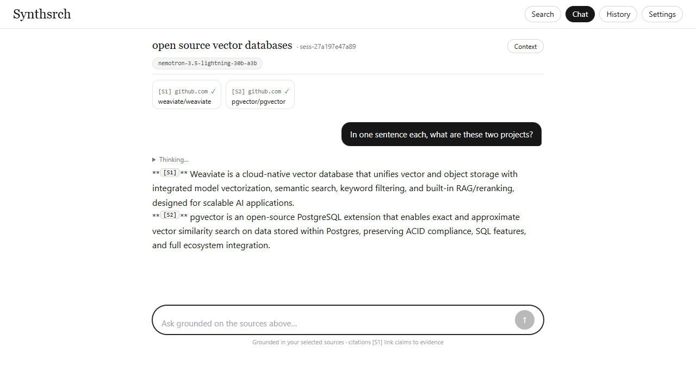
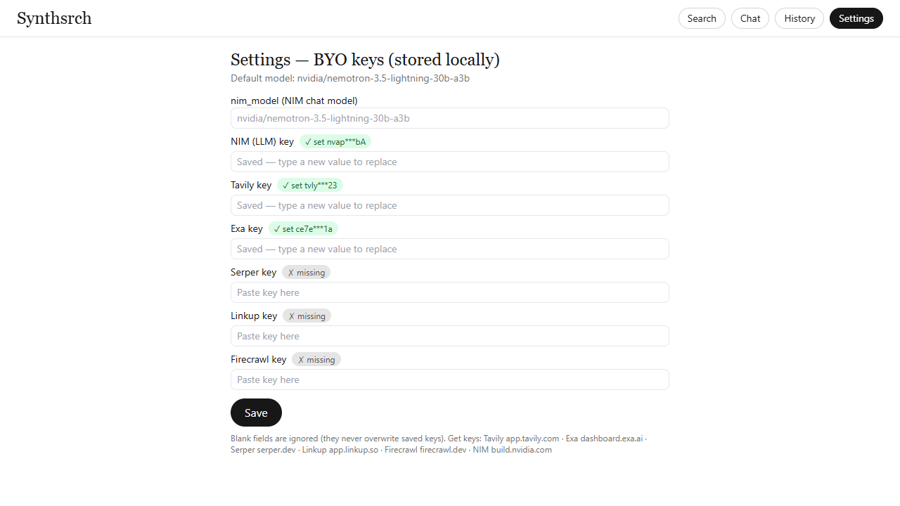

# Synthsrch — Learn without clutter.

A local-first, open-source search + synthesis app for Windows. It runs entirely on
`127.0.0.1`: you type `synthsrch` in the terminal and a browser tab opens with the app.
Only calls to the search / LLM providers you configure ever leave the machine.

It solves two problems:

1. **Browser-tool friction** — lag on low-end laptops, subscriptions, and pasting
   code into someone else's cloud tab. All orchestration is local; providers are
   used for searching only, with your own API keys.
2. **AI-chat clutter** — long flat chatbot threads lose focus. Synthsrch keeps research
   structured: **search → check sources → export to a grounded chat** whose prompt
   carries `{topic, purpose, domainKeywords}` and whose answers cite `[S1]…[Sn]`.

## Features (v1)

- **Multi-provider search, your keys** — Tavily, Exa, Serper, Linkup, Firecrawl.
  Pick one provider per search in the UI. No auto-fallback in v1: a bad key returns
  a named error, never a silent switch.
- **Result control** — result count, rank bracket (e.g. ranks 20–40), keyword
  filtering (`ANY` union / `ALL` intersection), sub-topic box, and a
  search-within-results filter that works locally without spending another search.
- **Note-card results** — rounded cards showing publisher, title, and `#rank`;
  checkboxes select sources; clicking a card opens clean raw text.
- **Local-only extraction** — page text is fetched with `httpx` and cleaned with
  `trafilatura` (primary) / `crawl4ai` (JS-heavy fallback). Search APIs are never
  used for crawling. No images, video, or scripts reach the reader or the model.
- **Structured chat (NIM)** — export checked sources into a session;
  the model (free-typed custom IDs) answers grounded in the
  excerpts with inline citations, streamed token-by-token. Stop button included.
- **Persistent history** — searches, cached results/extracts, sessions, and
  settings survive restarts in a local SQLite database.
- **Single-command launch** — `synthsrch` starts the server and opens the browser.

## Architecture

```
PS> synthsrch
     │  finds a free port (default 8765), starts Uvicorn on 127.0.0.1,
     │  opens http://127.0.0.1:8765
     ▼
┌──────────── FastAPI (one process) ────────────┐
│  /api/search    → manual provider dispatch     │
│                   (tavily|exa|serper|linkup|   │
│                    firecrawl — search ONLY)    │
│  /api/extract   → httpx + trafilatura,        │
│                   fallback crawl4ai           │
│  /api/sessions… → JSON prompt builder +       │
│                   NIM /v1/chat/completions   │
│                   (SSE streaming)             │
│  /api/history·settings·models·doctor          │
│  /               → serves the built Vite UI   │
└───────────────────────┬───────────────────────┘
                        │ SQLite (%APPDATA%/synthsrch/synthsrch.db):
                        │ searches, results_cache, sessions,
                        │ messages, settings
```

**Request flows**

- *Search:* `POST /api/search {query, provider, count, rank_start, rank_end,
  keywords, keyword_mode, subtopics}` → provider adapter normalizes to one
  `SearchResult` schema → keyword filter → rank slice → rows **upserted** into
  `results_cache` (repeat searches never 500 on duplicate IDs; cached extracts
  are preserved).
- *Extract:* `POST /api/extract {url, result_id}` → local fetch → cleaned text
  (+ `via: trafilatura|crawl4ai`) → stored on the cache row for chat grounding.
- *Chat:* `POST /api/sessions` (topic/purpose/keywords/sourceIds/model) →
  `POST /api/sessions/{id}/chat {query}` → deterministic system prompt +
  truncated excerpts → NIM `stream:true` → SSE `data:` deltas (content + reasoning), persisted on
  `[DONE]`.

**Key design rules**

- Provider responses are validated as untrusted input at the boundary.
- Search APIs do searching only — no `include_raw_content`, `/extract`,
  `/contents`, or `scrapeOptions` calls anywhere in v1.
- The server binds `127.0.0.1` only; CORS allows localhost origins only.
- Keys are masked in every API response and log; blank PUT values can never
  wipe a saved key.

## Project structure

```
SPEC.md                  → product spec (source of truth)
backend/synthsrch/
  __main__.py            → `synthsrch` CLI (serve / doctor)
  app.py                 → FastAPI routes + static UI mount
  config.py              → pydantic-settings, NIM model list
  db.py / models.py      → async SQLite engine + tables
  providers/             → base schema + tavily/exa/serper/linkup/firecrawl adapters
  extract.py             → local-only clean-text pipeline
  chat.py                → system/user prompt builders + NIM client
  static/                → built UI (generated by `npm run build`, committed)
frontend/src/
  App.tsx                → views + search state
  components/            → ChatView, FilterPanel
  views/                 → SettingsView, HistoryView
  lib/                   → api.ts, types.ts, chat.ts (citations, safe links)
tests/backend/           → pytest suite (filters, prompts, search upsert, settings persist, chat excerpts, SSRF guards)
install.ps1              → Windows one-step installer
```

## Requirements

- Windows 10/11, Python 3.11+ (via the `py` launcher is fine), Node 18+ (only
  needed if you rebuild the UI yourself).
- `crawl4ai-setup` after install (one time, ~300MB browsers) — enables the
  fallback extractor for JavaScript-rendered pages. Without it, plain pages
  still extract via trafilatura; JS-only pages report `EXTRACT_FAILED`.
- API keys you bring yourself: at least one search key
  ([Tavily](https://app.tavily.com) · [Exa](https://dashboard.exa.ai) ·
  [Serper](https://serper.dev) · [Linkup](https://app.linkup.so) ·
  [Firecrawl](https://firecrawl.dev)) and an
  [NIM key](https://build.nvidia.com) for chat.

## Install & run

Prerequisites: Windows 10/11. Nothing else — Option A installs Python 3.12
itself if missing (via winget) and fetches the code (git, or a zip download
if git is absent).

### Option A — one-liner (recommended)

Paste into PowerShell. No files to download, nothing to double-click
(double-clicking a `.ps1` opens Notepad — that path never works):

```powershell
powershell -ExecutionPolicy Bypass -c "irm https://raw.githubusercontent.com/spectaculardipin/Synthsrch/main/bootstrap.ps1 | iex"
```

This installs Python if needed, gets the code, runs `pip install .`, adds
Python `Scripts` to your user PATH, installs the browser engine (~300MB),
and verifies with `synthsrch doctor`. Then launch:

```powershell
synthsrch          # opens http://127.0.0.1:8765
py -m synthsrch    # fallback: same app, works in any terminal, PATH or not
```

If `synthsrch` is not recognized, open a NEW terminal and retry (PATH
changes need one) — or just use the `py -m synthsrch` fallback.

### Option B — manual (you already have Python 3.11+ and the code)

The helper `.\install.ps1` **replaces** the manual commands below: run it from
the repo root *instead of* the manual steps, not after them. It does NOT
install Python itself — it errors clearly if Python is missing (use Option A then).

```powershell
git clone https://github.com/spectaculardipin/Synthsrch.git
cd Synthsrch
.\install.ps1
```

If Windows blocks the script (`running scripts is disabled`), use:

```powershell
powershell -ExecutionPolicy Bypass -File .\install.ps1
```

Or fully manual:

```powershell
git clone https://github.com/spectaculardipin/Synthsrch.git
cd Synthsrch
py -m pip install .   # trailing `.` means "the package in this folder"
crawl4ai-setup        # browser engine for JS pages, ~300MB, one time (optional)
synthsrch             # opens http://127.0.0.1:8765 (fallback: py -m synthsrch)

# handy variants
synthsrch --port 8765 --no-browser
synthsrch doctor      # python, exe PATH status, db path, key presence
```

No Docker, no background services. The SQLite database is created on first run at
`%APPDATA%\synthsrch\synthsrch.db` (or `~/.synthsrch/` elsewhere).

## Configure

Open **Settings** in the app (or set `SYNTHSRCH_*` env vars):

| Field            | Env var                  | Notes                                                        |
|------------------|--------------------------|--------------------------------------------------------------|
| `tavily_api_key` | `SYNTHSRCH_TAVILY_API_KEY` | Web search, `max_results ≤ 20` per call                    |
| `exa_api_key`    | `SYNTHSRCH_EXA_API_KEY`    | Neural search, up to 100 results                           |
| `serper_api_key` | `SYNTHSRCH_SERPER_API_KEY` | Google SERP, cheap and fast                                |
| `linkup_api_key` | `SYNTHSRCH_LINKUP_API_KEY` | Agentic search, `depth: standard` default                  |
| `firecrawl_api_key` | `SYNTHSRCH_FIRECRAWL_API_KEY` | Search endpoints only in v1                            |
| `nim_api_key`   | `SYNTHSRCH_NIM_API_KEY`      | Required for chat (`nvapi-…` key from build.nvidia.com)    |
| `nim_model`     | `SYNTHSRCH_NIM_MODEL`        | Curated list in UI, or type any NIM model ID               |

Settings persist in SQLite and are re-loaded on startup. The UI shows ✓/✗ per
key (masked) and blanks never overwrite saved values.

## Usage


1. **Search** — type a query, open ⚙ for provider / count / rank bracket /
   keywords (`ANY`|`ALL`) / sub-topic. Results arrive as note cards.


2. **Read** — click a card for clean text (`via trafilatura|crawl4ai`, char count
   shown). Filter further with *Search within these results* (free, local).
3. **Synthesize** — check 2–5 cards → **Export → Chat**. Full text for every
   source is extracted automatically in the background (✓/…/✗ per source in
   the rail; Send unlocks when ready, failures retryable). Set topic, purpose,
   domain keywords, and model; ask questions. Answers cite `[S1]`…`[Sn]`,
   mapped to the sources rail above the thread.



4. **Resume** — **History** lists past searches and sessions across restarts.



## API reference (local)

| Method | Endpoint                    | Purpose                                              |
|--------|-----------------------------|------------------------------------------------------|
| GET    | `/api/health`               | liveness + db path + model                           |
| GET    | `/api/models`               | NIM model list + default                             |
| POST   | `/api/search`               | provider search → ranked, sliced `SearchResult[]`    |
| POST   | `/api/extract`              | local clean-text extraction for a URL                |
| POST   | `/api/sessions`             | create structured chat session                       |
| POST   | `/api/sessions/{id}/chat`   | streamed (SSE) grounded answer                       |
| GET    | `/api/history`              | searches + sessions                                  |
| GET/PUT| `/api/settings`             | masked key status / save keys + model                |
| GET    | `/api/doctor`               | environment diagnostics                              |

Errors share one shape: `{ "error": { "code": "MISSING_KEY|PROVIDER_ERROR|…", "message": "…" } }`.

## Development

```powershell
py -m pip install -e ".[dev]"     # backend + pytest/ruff
py -m pytest -q                   # backend tests
cd frontend; npm install; npm test -- --run   # frontend tests
cd frontend; npm run build         # rebuild backend/synthsrch/static
```

`SPEC.md` is the source of truth; the `tasks/` convention from
`planning-and-task-breakdown` applies to larger changes.

## Troubleshooting

| Symptom | Fix |
|---------|-----|
| `ERROR: You must give at least one requirement to install` | The trailing `.` in `py -m pip install .` is part of the command (it means "install the package in this folder"). Re-run with the dot, from the repo root: `cd Synthsrch`, then `py -m pip install .` |
| `pyproject.toml not found` / `Directory '.' is not installable` | You ran install from the wrong folder. `cd Synthsrch` first (the folder containing `pyproject.toml`), then retry |
| `pip` not recognized | Use `py -m pip install .` (Python ships via the `py` launcher) |
| `synthsrch` / `crawl4ai-setup` is not recognized | Python `Scripts` dir isn't on PATH. Open a NEW terminal and retry (PATH changes need one); or run `.\install.ps1` again (it adds `Scripts` to your user PATH); or bypass PATH entirely with `py -m synthsrch` |
| `.\install.ps1` cannot be loaded / running scripts is disabled | Fresh Windows blocks local scripts. Run `powershell -ExecutionPolicy Bypass -File .\install.ps1` (one-time bypass, no system change) |
| `No module named synthsrch` from `py -m synthsrch` | The install went to a different Python (multiple installs on one machine). Check `py --version` vs `pip --version`, then install and run with the SAME launcher: `py -m pip install .` and `py -m synthsrch doctor` |
| Port busy | The CLI auto-picks the next free port; or `synthsrch --port 8775` |
| `MISSING_KEY` on search | Add that provider's key in Settings (v1 never falls back silently) |
| `PROVIDER_ERROR 502` | Key invalid / credits exhausted / provider hiccup — retry or switch provider |
| `EXTRACT_FAILED` | JS-heavy page without `crawl4ai-setup`, blocked/non-public URL, or site blocking bots — try another source |
| Chat streams `[error: …]` | NIM key missing/invalid, unknown model ID, or timeout — check Settings |

## License

MIT — see [LICENSE](LICENSE).
