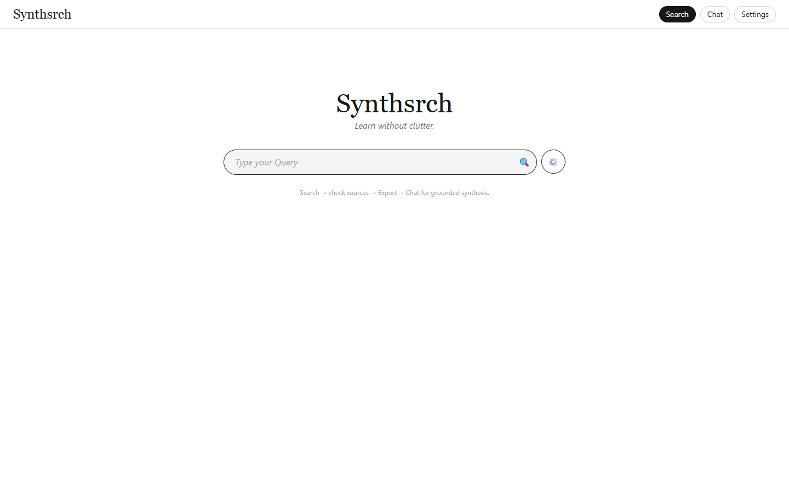
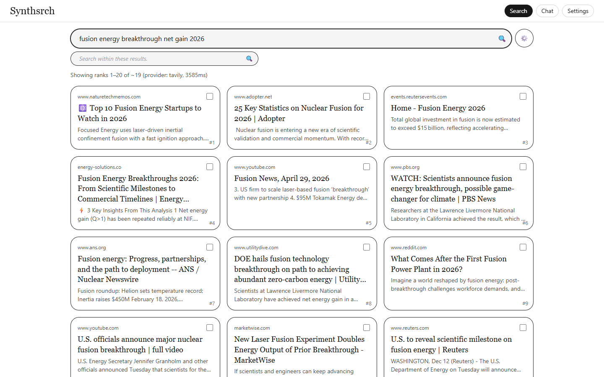
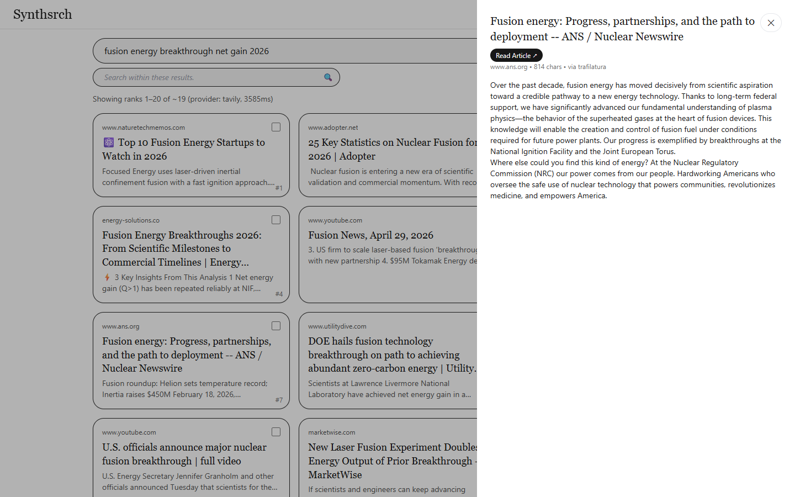
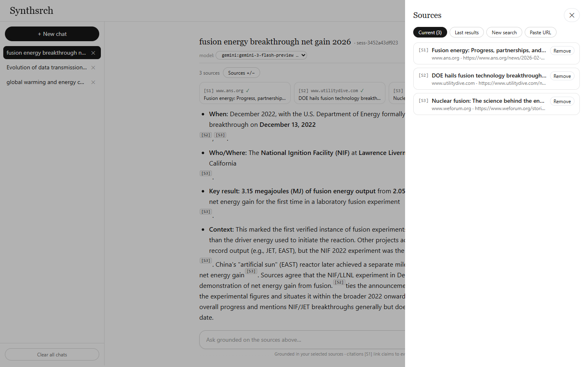
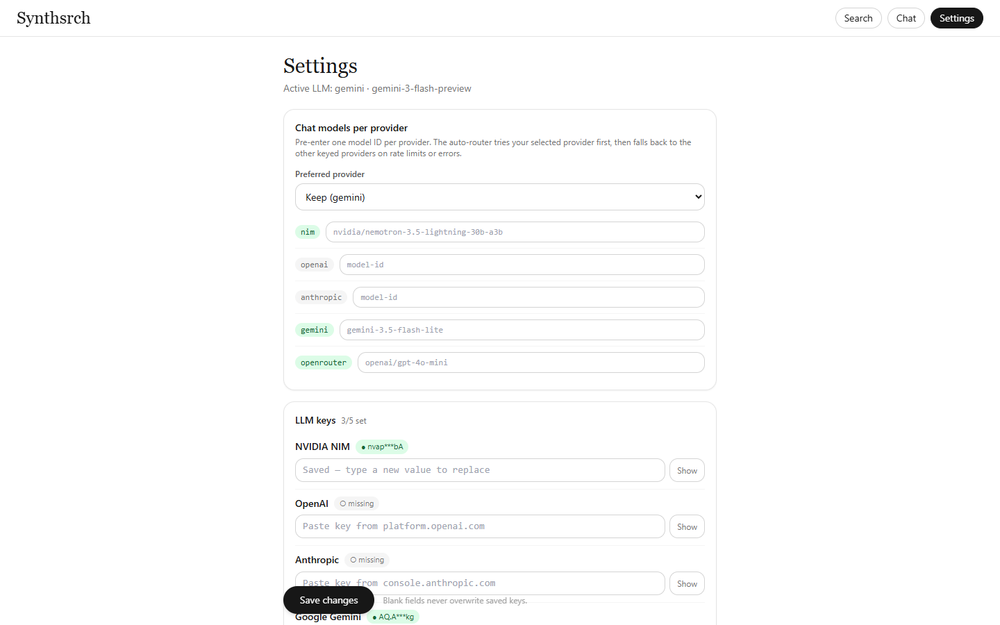

# Synthsrch v2 — Learn without clutter.

A local-first, open-source search + synthesis app for Windows. It runs entirely on
`127.0.0.1`: you type `synthsrch` in the terminal and a browser tab opens with the app.
Only calls to the search / LLM providers you configure ever leave the machine.

It solves two problems:

1. **Browser-tool friction** — lag on low-end laptops, subscriptions, and pasting
   code into someone else's cloud tab. All orchestration is local; providers are
   used with your own API keys.
2. **AI-chat clutter** — long flat chatbot threads lose focus. Synthsrch keeps research
   structured: **search → check sources → export to a grounded chat** whose prompt
   carries `{topic, purpose, domainKeywords}` and whose answers cite `[S1]…[Sn]`.

**V2 changes:** silent auto-fallback across search providers; five LLM providers
(NIM, OpenAI, Anthropic, Gemini, OpenRouter) with a visible router-switch notice;
Claude-grade markdown chat with a session sidebar and a mid-chat sources drawer;
browser fallback for bot-blocked pages. See [What's new in v2](#whats-new-in-v2).

## Features

- **Self-healing search** — Tavily, Exa, Serper, Linkup, Firecrawl. Pick a provider
  or `auto` (default). On rate limits/errors the next key-configured provider is
  tried silently — one provider billed per search, never a dead end.
- **Five LLM providers, your keys** — NIM, OpenAI, Anthropic, Gemini, OpenRouter.
  Pre-enter one model ID per provider in Settings; the chat tries your pick first,
  then falls back only on failure. Every switch posts a small
  `⇄ X failed (reason) — switched to Y:model` notice in the thread (persisted).
- **Pro chat** — markdown answers (headings, bullets, code, tables) with inline
  `[S1]` citation badges, thinking/reasoning blocks, stop button, token streaming.
- **Session sidebar** — list, resume, per-chat delete, clear-all. No separate History
  page; chat is always one click away.
- **Sources drawer, mid-chat** — Current / Last results / New search / Paste URL.
  Adds re-extract automatically; removals apply immediately. Sources open in a new
  tab; the reader shows a **Read Article ↗** link.
- **Result control** — result count, rank bracket (e.g. ranks 20–40), keyword
  filtering (`ANY` union / `ALL` intersection), sub-topic box, and a
  search-within-results filter that works locally without spending another search.
- **Local-only extraction** — page text is fetched with `httpx` and cleaned with
  `trafilatura` (primary) / `crawl4ai` Chromium fallback. Soft bot-blocks
  (401/403/429) automatically retry in the browser; search APIs are never used
  for crawling. No images, video, or scripts reach the reader or the model.
- **Persistent everything** — searches, cached results/extracts, sessions
  (incl. switch notices), and settings survive restarts in local SQLite.
- **Single-command launch** — `synthsrch` starts the server and opens the browser.

## Architecture

```
PS> synthsrch
     │  finds a free port (default 8765), starts Uvicorn on 127.0.0.1,
     │  opens http://127.0.0.1:8765
     ▼
┌──────────── FastAPI (one process) ────────────┐
│  /api/search    → silent router: requested/    │
│                   auto → keyed providers       │
│                   (tavily|exa|serper|linkup|   │
│                    firecrawl — search ONLY)    │
│  /api/extract   → httpx + trafilatura,        │
│                   401/403/429 → crawl4ai       │
│  /api/sessions… → hidden NotebookLM-style     │
│                   prompt + 5-provider LLM      │
│                   router (SSE: delta,          │
│                   reasoning, notice)           │
│  /api/models·settings·doctor·history          │
│  /               → serves the built Vite UI   │
└───────────────────────┬───────────────────────┘
                        │ SQLite (%APPDATA%/synthsrch/synthsrch.db):
                        │ searches, results_cache, sessions,
                        │ messages (user/assistant/notice), settings
```

**Request flows**

- *Search:* `POST /api/search {query, provider(auto?), count, rank_start, rank_end,
  keywords, keyword_mode, subtopics}` → router tries providers in order → adapters
  normalize to one `SearchResult` schema → keyword filter → rank slice → rows
  **upserted** into `results_cache` (repeat searches never 500 on duplicates;
  cached extracts preserved). The `showing` line names the provider used.
- *Extract:* `POST /api/extract {url, result_id}` → local fetch → cleaned text
  (+ `via: trafilatura|crawl4ai`) → stored on the cache row for grounding.
- *Chat:* `POST /api/sessions` (topic/purpose/keywords/sourceIds/provider/model) →
  `POST /api/sessions/{id}/chat {query, provider, model}` → hidden system prompt +
  truncated excerpts → preferred `provider:model`, fallback chain on failure →
  SSE `data:` events (`delta`, `reasoning`, `notice`), assistant text + notices
  persisted on `[DONE]`.
- *Sources:* `PATCH /api/sessions/{id}/sources {add[…], remove[…]}` — ids, fresh
  search results, or raw URLs (pasted rows are extracted server-side).

**Key design rules**

- Provider responses and LLM output are untrusted input: validated at the
  boundary, rendered sanitized (`rehype-sanitize`, http(s)-only links).
- Search APIs do searching only — no `include_raw_content`, `/extract`,
  `/contents`, or `scrapeOptions` calls anywhere.
- The server binds `127.0.0.1` only; CORS allows localhost origins only.
- Keys are masked in every API response; `sanitize_error()` strips `key=`-style
  credentials from any error/notice text before it reaches chat or logs; blank
  PUT values can never wipe a saved key.

Decisions behind all of the above: `docs/decisions/` (ADRs 001–003).

## Project structure

```
SPEC.md                  → v1 product spec (historical)
docs/decisions/          → ADRs: auto-routers, pro chat, extract fallback
backend/synthsrch/
  __main__.py            → `synthsrch` CLI (serve / doctor)
  app.py                 → FastAPI routes + static UI mount
  config.py              → pydantic-settings, keys + per-provider models
  db.py / models.py      → async SQLite engine + tables
  providers/             → base schema + tavily/exa/serper/linkup/firecrawl adapters
  search_service.py      → silent sequential fallback router
  llm/                   → base dispatch + openai_compat/anthropic/gemini +
                           fallback_chain + key sanitizer helpers
  extract.py             → local-only clean-text pipeline (+soft-block fallback)
  chat.py                → hidden system prompt + multi-LLM streaming
  static/                → built UI (generated by `npm run build`, committed)
frontend/src/
  App.tsx                → views + search/chat state, buffered SSE reader
  components/            → ChatView (markdown+citations), ChatSidebar,
                           SourcesDrawer, FilterPanel
  views/                 → SettingsView (per-provider keys + models)
  lib/                   → api.ts, types.ts, chat.ts (citations, safe links),
                           sse.ts (chunk-proof event parser)
tests/backend/           → pytest suite (routers, prompts, fallback, sessions,
                           settings persist, chat excerpts, SSRF guards, caps)
install.ps1 / bootstrap.ps1 → Windows installers (PATH-proof one-liner)
```

## Requirements

- Windows 10/11, Python 3.11+ (via the `py` launcher is fine), Node 18+ (only
  needed if you rebuild the UI yourself).
- `crawl4ai-setup` after install (one time, ~300MB browsers) — enables the
  fallback extractor for JavaScript-rendered and bot-guarded pages. Without it,
  plain pages still extract via trafilatura.
- API keys you bring yourself (Settings page, or `SYNTHSRCH_*` env / `.env` —
  see `.env.example`): at least one search key and one LLM key. Two or more of
  each unlocks the auto-routers.

## Install & run

Prerequisites: Windows 10/11. Nothing else — Option A installs Python 3.12
itself if missing (via winget) and fetches the code (git, or a zip download
if git is absent).

### Option A — one-liner (recommended)

Paste into PowerShell. No files to download, nothing to double-click
(double-clicking a `.ps1` opens Notepad — that path never works):

```powershell
powershell -ExecutionPolicy Bypass -c "irm https://raw.githubusercontent.com/spectaculardipin/Synthsrch/main/bootstrap.ps1 | iex"
```

This installs Python if needed, gets the code, runs `pip install .`, adds
Python `Scripts` to your user PATH, installs the browser engine (~300MB),
and verifies with `synthsrch doctor`. Then launch:

```powershell
synthsrch          # opens http://127.0.0.1:8765
py -m synthsrch    # fallback: same app, works in any terminal, PATH or not
```

If `synthsrch` is not recognized, open a NEW terminal and retry (PATH
changes need one) — or just use the `py -m synthsrch` fallback.

### Option B — manual (you already have Python 3.11+ and the code)

The helper `.\install.ps1` **replaces** the manual commands below: run it from
the repo root *instead of* the manual steps, not after them. It does NOT
install Python itself — it errors clearly if Python is missing (use Option A then).

```powershell
git clone https://github.com/spectaculardipin/Synthsrch.git
cd Synthsrch
.\install.ps1
```

If Windows blocks the script (`running scripts is disabled`), use:

```powershell
powershell -ExecutionPolicy Bypass -File .\install.ps1
```

Or fully manual:

```powershell
git clone https://github.com/spectaculardipin/Synthsrch.git
cd Synthsrch
py -m pip install .   # trailing `.` means "the package in this folder"
crawl4ai-setup        # browser engine for JS/bot-guarded pages, ~300MB, one time (optional)
synthsrch             # opens http://127.0.0.1:8765 (fallback: py -m synthsrch)

# handy variants
synthsrch --port 8765 --no-browser
synthsrch doctor      # python, exe PATH status, db path, key presence
```

No Docker, no background services. The SQLite database is created on first run at
`%APPDATA%\synthsrch\synthsrch.db` (or `~/.synthsrch/` elsewhere).

## Configure

Open **Settings** in the app (or set `SYNTHSRCH_*` env vars / copy `.env.example`
to `.env` — env values seed a fresh DB; the DB wins afterwards):

| Field(s) | Env var(s) | Notes |
|----------|-----------|-------|
| Search keys (≥1; ≥2 for fallback) | `SYNTHSRCH_TAVILY_API_KEY`, `_EXA_…`, `_SERPER_…`, `_LINKUP_…`, `_FIRECRAWL_API_KEY` | Tavily ≤20/call · Exa ≤100 · Serper cheap/fast · Linkup standard depth |
| LLM keys (≥1) | `SYNTHSRCH_NIM_API_KEY` (`nvapi-…`, build.nvidia.com) · `_OPENAI_…` · `_ANTHROPIC_…` · `_GEMINI_…` (Google AI Studio) · `_OPENROUTER_API_KEY` | Any subset works; router uses what's keyed |
| Models, one per provider | `SYNTHSRCH_NIM_MODEL`, `_OPENAI_MODEL`, `_ANTHROPIC_MODEL`, `_GEMINI_MODEL`, `_OPENROUTER_MODEL`, `_LLM_PROVIDER`, `_LLM_MODEL` | Free-text IDs; the chat-menu widget switches among saved pairs |

Settings persist in SQLite and are re-loaded on startup. The UI shows ✓/✗ per
key (masked) and blanks never overwrite saved values.

## Usage



1. **Search** — type a query, open ⚙ for provider (`auto` default) / count / rank
   bracket / keywords (`ANY`|`ALL`) / sub-topic. Results arrive as note cards;
   the `showing` line names the provider that answered.



2. **Read** — click a card for clean text (`via trafilatura|crawl4ai`, char count
   shown) plus a **Read Article ↗** link. Filter further with *Search within
   these results* (free, local).



3. **Synthesize** — check 2–5 cards → **Export → Chat**. Full text for every
   source is extracted automatically in the background (✓/…/✗ per source in
   the rail; Send unlocks when ready, failures retryable). Set topic, purpose,
   domain keywords, and model (or pick a saved pair from the `model:` widget);
   ask questions. Answers cite `[S1]`…`[Sn]`; a `⇄` pill explains any model
   switch and stays in history.


4. **Manage sources mid-chat** — **Sources +/−**: remove duds, add from last
   results, run a new search, or paste any URL. The next answer uses the new set.



5. **Resume** — the sidebar lists every conversation across restarts, with
   per-chat delete and clear-all.



## API reference (local)

| Method | Endpoint | Purpose |
|--------|----------|---------|
| GET | `/api/health` | liveness + db path + model |
| GET | `/api/models` | providers + default + pre-entered `configured[]` pairs |
| POST | `/api/search` | routed provider search → ranked, sliced `SearchResult[]` |
| POST | `/api/extract` | local clean-text extraction for a URL |
| POST | `/api/sessions` | create chat session (provider + model + sources) |
| GET | `/api/sessions` | session list (sidebar) |
| GET/DELETE | `/api/sessions/{id}` | full thread (messages+sources) / delete incl. messages |
| DELETE | `/api/sessions` | clear all chats |
| PATCH | `/api/sessions/{id}/sources` | add (ids / search hits / URLs) + remove |
| POST | `/api/sessions/{id}/chat` | streamed answer: SSE `delta`, `reasoning`, `notice` |
| GET | `/api/history` | searches + sessions (legacy) |
| GET/PUT | `/api/settings` | masked key status / save keys + per-provider models |
| GET | `/api/doctor` | environment diagnostics |

Errors share one shape: `{ "error": { "code": "MISSING_KEY|PROVIDER_ERROR|…", "message": "…" } }`.
Streaming ends with `data: [DONE]`; a stream cut early yields a retry hint instead
of silence.

## Performance notes (measured, localhost)

- API medians: `/api/health` ~30ms, `/api/models` ~13ms, `/api/sessions` ~14ms.
- UI bundle 350KB JS (~108KB gzip) served from loopback — no code-splitting
  (would buy nothing here); markdown re-parse per token accepted for typical
  answer lengths.
- Extraction: fast path first, Chromium capped at 2 concurrent runs; chat
  gap-fill stays on the fast path so sending never stalls on a slow page.
- Lists are capped (`results_cache` upserts, 50/100-row history limits, 10
  sources/chat, `max_tokens ≤ 16384`).

## Security posture

Localhost-only by design: binds `127.0.0.1`, CORS allowlists localhost origins,
no auth (single-user tool — do not expose the port). SSRF guard on every
fetched URL and redirect hop; input caps on all endpoints (`422` otherwise);
ORM-only queries; `X-Content-Type-Options`/`X-Frame-Options`/referrer headers;
LLM markdown sanitized, provider URLs link-checked. Production audit
(`npm audit --omit=dev`) is clean; dev-only advisories (vitest/tailwind
transitives) and the unpatched transitive `nltk` sandbox note are deferred as
unreachable — re-check with each dependency upgrade.

## What's new in v2

- Search auto-router (silent, sequential, one provider billed).
- 5 LLM providers + per-provider models + switch notices + chat-menu widget.
- Markdown chat, session sidebar (History page removed), sources drawer.
- 401/403/429 extraction retry in a real browser.
- Buffered SSE reader (split-payload stalls fixed), Gemini thought separation.
- `.env.example`, `docs/decisions/` ADRs, input caps, key redaction everywhere.

## Development

```powershell
py -m pip install -e ".[dev]"     # backend + pytest/ruff
py -m pytest -q                   # backend tests (69)
cd frontend; npm install; npm test -- --run   # frontend tests (11)
cd frontend; npm run build         # rebuild backend/synthsrch/static
```

`SPEC.md` covers v1 history; v2 intent lives in `tasks/plan-v2.md` and
`docs/decisions/`.

## Troubleshooting

| Symptom | Fix |
|---------|-----|
| `ERROR: You must give at least one requirement to install` | The trailing `.` in `py -m pip install .` is part of the command (it means "install the package in this folder"). Re-run with the dot, from the repo root: `cd Synthsrch`, then `py -m pip install .` |
| `pyproject.toml not found` / `Directory '.' is not installable` | You ran install from the wrong folder. `cd Synthsrch` first (the folder containing `pyproject.toml`), then retry |
| `pip` not recognized | Use `py -m pip install .` (Python ships via the `py` launcher) |
| `synthsrch` / `crawl4ai-setup` is not recognized | Python `Scripts` dir isn't on PATH. Open a NEW terminal and retry (PATH changes need one); or run `.\install.ps1` again (it adds `Scripts` to your user PATH); or bypass PATH entirely with `py -m synthsrch` |
| `.\install.ps1` cannot be loaded / running scripts is disabled | Fresh Windows blocks local scripts. Run `powershell -ExecutionPolicy Bypass -File .\install.ps1` (one-time bypass, no system change) |
| `No module named synthsrch` from `py -m synthsrch` | The install went to a different Python (multiple installs on one machine). Check `py --version` vs `pip --version`, then install and run with the SAME launcher: `py -m pip install .` and `py -m synthsrch doctor` |
| Port busy | The CLI auto-picks the next free port; or `synthsrch --port 8775` |
| Search shows another provider than chosen | Normal: the router fell back after a failure. Add/fix keys in Settings. |
| `⇄ X failed (…) — switched to Y` pill in chat | The router moved you after a failure (reason shown). Switch models via the `model:` widget or Settings. |
| Thinking box with odd content | Reasoning models think out loud; quality varies by model. Gemini thought traces are separated automatically; for other providers pick a non-reasoning model. |
| Answer stops mid-way | The app now says so explicitly (`[error: …]` or a retry hint). Re-send; persistent cuts mean the provider is flapping — switch models. |
| `EXTRACT_FAILED` / refused-reading error | Login-walled, captcha, or hard-blocked page — try another source. 401/403/429 already retry in the browser automatically. |
| Chat streams `[error: …]` | Key missing/invalid, unknown model ID, or all providers failing — check the notice pills, then Settings. |

## License

MIT — see [LICENSE](LICENSE).
